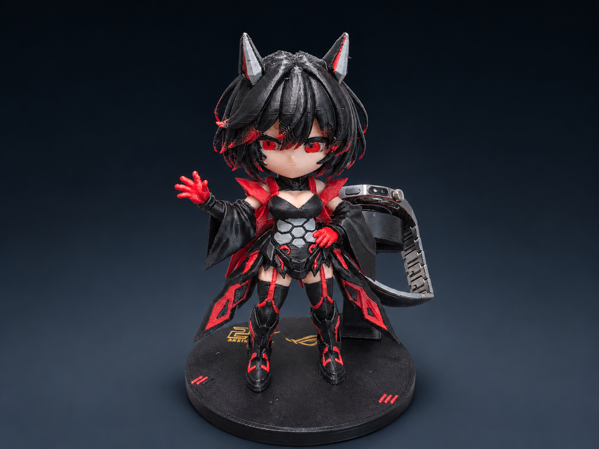

# ROG 风格 Q 版手表充电摆件

集 Q 版机甲少女桌面摆件和手表充电托于一体的 FDM 打印项目，适配用户自备的华为 WATCH 6 原装充电器。

## 下载与版本

| 文件 | 用途 |
|---|---|
| [纯黑头发、无混色版](P1S_black_hair_no_mixing_10parts_5plates.3mf) | 当前主版，10件5盘，取消全部虚拟混色。 |
| [原红黑混色头发参考版](P1S_original_red_black_mixed_hair.3mf) | 保留红黑虚拟混色供 Bambu Studio 本地使用；不要将其视为已通过 MakerWorld 云端验证的打印配置。 |
| [15秒环绕视频](colored_model_orbit_15s.mp4) | 彩色数字模型渲染，包含眼片；视频展示的是红黑发色参考版。 |
| 实物照片 `printed_sample_01.jpg` 至 `printed_sample_06.jpg` | 已打印样品的原始照片；实物为此前打印版本，不等同于新眼片和纯黑发版已完成实测。 |

## 打印设置

- 打印机：Bambu Lab P1S，0.4 mm 喷嘴；PLA；纹理 PEI 板。
- 喷嘴220℃，热床55℃，首层0.16 mm。
- 头部：0.12 mm层高、3层墙、15%螺旋体填充。
- 身体、底座、充电托、立柱和线槽盖：0.16 mm层高、3层墙、15%填充。
- 两只眼片：B档薄版，0.08 mm层高、2层墙、100%填充；画面左眼上缘已小幅修顺。
- 两根脚定位销：0.08 mm层高、3层墙、100%填充。
- 人物使用肉色、红色、黑色、灰色；底座图案另用金色，在底座盘单独安排耗材。主版五个逻辑耗材槽均为普通 PLA，不含虚拟混色定义。
- 工程保存了各对象的独立支撑参数、手工支撑标记及打印朝向，请以3MF中的对象参数为准。

## 结构与使用

头部、身体和眼片分件打印后装配。底座上盖与底壳为连通一体结构；充电外托与华为适配环为一体结构；立柱与充电托通过三角形插销定位。ROG 20周年图案与底座顶面齐平。

充电功能依赖自行安装的原装充电器，本项目不包含充电电子电路。用户反馈华为 WATCH 6 的装配和充电正常；本仓库不声称已验证 Apple Watch 适配。新修订的薄眼片仍需按实际打印情况试装。

## 验证范围

纯黑头发版的头部盘和底座盘已通过本地 Bambu Studio 切片检查，均无切片警告。模型几何、其他部位的上色、打印朝向及手工支撑保持不变。

## 文件校验

下载后可用 [SHA256SUMS.txt](SHA256SUMS.txt) 校验模型和媒体文件。
